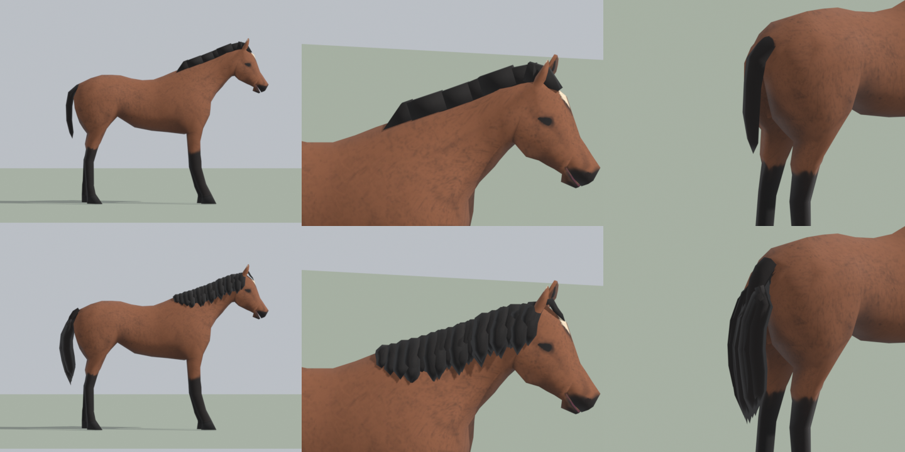
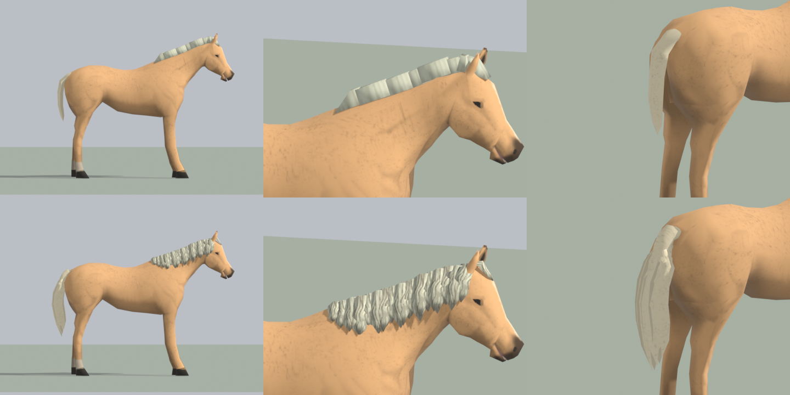

# Horse Mane & Tail improved

Project Zomboid (Build 42) add-on for the [Horse mod](https://steamcommunity.com/sharedfiles/filedetails/?id=3661336777) that gives adult horses a new mane and tail.



- **Mane:** layered locks that arc over the crest and fall to one side of the neck, with a forelock between the ears. The Horse mod still tints it in each breed's mane colour.
- **Tail:** a proper dock with a fuller, longer bundle of hair that reaches the hocks. It stays in each breed's tail colour, because its UVs land inside the tail area of the breed textures.
- Mares and stallions share the new models. Foals are unchanged.

It only replaces model files, so there is no Lua, no scripts and nothing saved: it can be added to or removed from an existing save.



## How it works

The Horse mod builds a horse from a skinned body mesh plus seven mane pieces attached to bones along the crest (`DEF_ManeStart`, `DEF_ManeMid1`-`5`, `DEF_ManeEnd`). This mod ships files at the same paths, and `loadModAfter=\Horse` makes them win:

| File | What changed |
|---|---|
| `models_X/HorseMod/SimpleManeStart.glb`, `SimpleManeMid.glb`, `SimpleManeEnd.glb` | the 12-triangle boxes become layered hair locks (84-112 triangles each) |
| `models_X/HorseMod/Horse/Mare.glb`, `Mare_NoHead.glb`, `Stallion.glb`, `Stallion_NoHead.glb` | the old tail (36 triangles) is cut out and a new dock and hair bundle (440 triangles) is added, skinned to `DEF_Tail1`-`3`. The skeleton, inverse bind matrices and every other vertex are untouched |

Things worth knowing:

- Attached models are drawn through the bone's model transform, which carries the skeleton's 0.6 scale, so mane pieces are modelled 1/0.6 larger than they appear.
- The mane bones sit about 19° differently in every animation than in the bind pose, so the mane is shaped against the neck as it is posed in `Horse_Idle`, not the bind pose.
- Removing the old tail leaves a small opening in the rump; it is capped with two triangles.

## Building

The models are generated by Python scripts in `blender/`, run with the Python that ships with Blender (it has numpy). Nothing in the Horse mod folder is ever written to.

```bash
"E:/SteamLibrary/steamapps/common/Blender/5.2/python/bin/python.exe" blender/build.py
```

```bash
"E:/SteamLibrary/steamapps/common/Blender/5.2/python/bin/python.exe" blender/verify.py
```

`build.py` copies the original body meshes into `blender/reference/` the first time (git-ignored), then writes every model into `Contents/`. `verify.py` checks the result: the skeleton is unchanged, skin weights are normalised, every new tail UV lands inside the tail strips, no new holes, and the mane pieces are closed meshes.

The paths to the Horse mod and the game default to this machine's Steam folders; set `HORSE_MOD_DIR` and `PZ_DIR` to override them.

### Previews

`preview.py` assembles a horse the way the game does (posed by one of the Horse mod's animations, mane pieces on their bones, breed texture, mane tint) and renders it in Blender:

```bash
"E:/SteamLibrary/steamapps/common/Blender/blender.exe" --background --factory-startup --python blender/preview.py -- --models "Contents/mods/PZHorseManeAndTailImproved/common/media/models_X/HorseMod" --breed ThoroughbredBay --anim Horse_Gallop.glb --time 0.3 --out blender/_work/gallop.png
```

Add `--compare <Horse mod models_X/HorseMod folder>` for a before/after sheet. `poster.py` renders `poster.png`, `icon.png` and `preview.png`.

### Tuning

- `blender/mane.py`: `SIDE` (which side the mane falls to), the lock lists in `build_pieces()` (position along the crest, length, width, layer), `forelock()`.
- `blender/tail.py`: `CLUMPS` (angle, root position on the dock, tip height, layer), `DOCK_PATH`, `DOCK_RADIUS`, `DEPTH_SCALE`.

## Credits

The body meshes in this mod are the Horse mod's mare and stallion models with the tail replaced. The Horse mod, its models and textures are by the [Horse team](https://github.com/PZ-HorseTeam/HorseMod).
